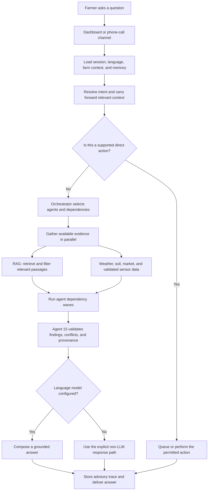
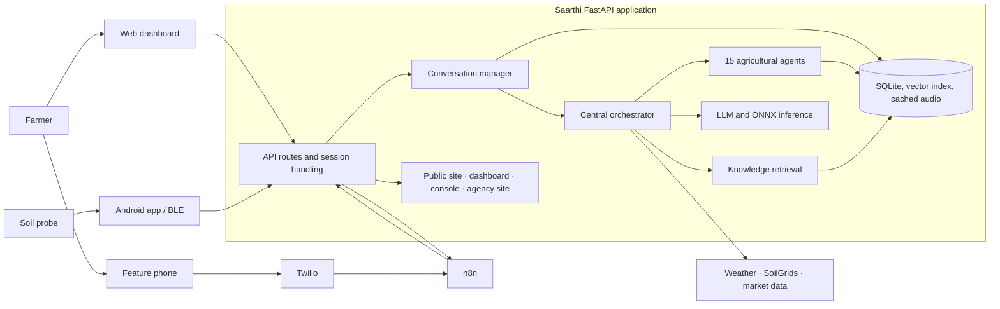
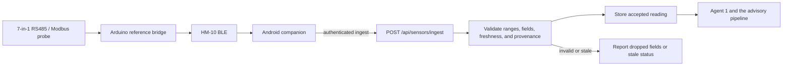
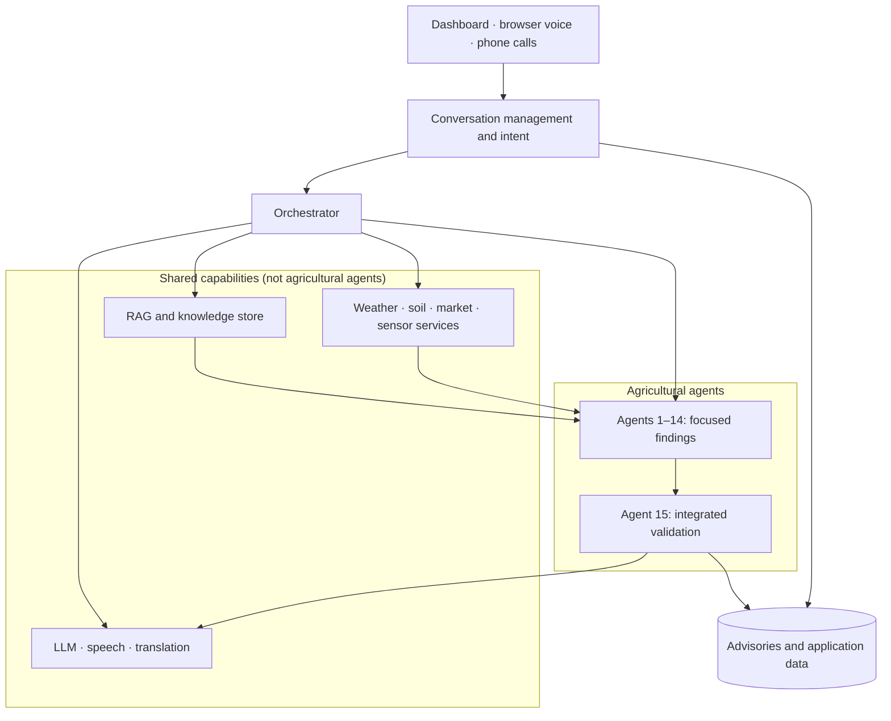
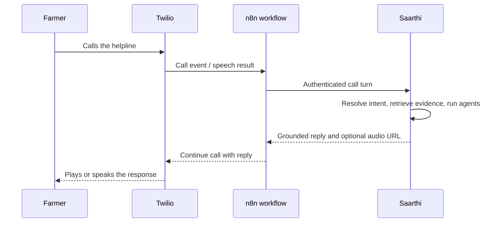

# Saarthi 2.0

### A multilingual farming companion, from field data to a grounded advisory

Saarthi brings a farmer-facing dashboard, conversational AI, retrieval-augmented generation (RAG), **15 agricultural advisory agents**, voice and phone-call integrations, and a 7-parameter soil-sensor path together behind one FastAPI application.

| | |
|---|---|
| **Project** | InduX 5.0 · Problem Statement 16 · Multilingual AI & Language Technologies |
| **Team** | VisionCoders · InduX5-26VU-404 |
| **Public site** | [indux5.0.visioncoders.in](https://indux5.0.visioncoders.in) |
| **API** | FastAPI · OpenAPI / Swagger UI at `/docs` |

> **Important:** Saarthi provides decision support, not a substitute for local agricultural expertise. Photo results are screening evidence, not a diagnosis. The system intentionally does not prescribe pesticide products, doses, or spray schedules.

---

## Contents

- [What Saarthi does](#what-saarthi-does)
- [Architecture](#architecture)
- [The 15-agent advisory team](#the-15-agent-advisory-team)
- [Run locally](#run-locally)
- [Configuration and integrations](#configuration-and-integrations)
- [Application surfaces and API](#application-surfaces-and-api)
- [Tests](#tests)
- [Repository map](#repository-map)
- [Safety, privacy, and known limits](#safety-privacy-and-known-limits)
- [Documentation](#documentation)
- [Troubleshooting](#troubleshooting)

---

## What Saarthi does

- **Answers farm questions** using the farmer's language, farm context, retrieved knowledge, and explicit findings from agricultural agents.
- **Shows its work:** retrieved sources, dates, units, assumptions, warnings, missing inputs, and simulated or stale data are carried through the advisory.
- **Supports voice** through browser speech features and optional speech/LLM providers.
- **Connects feature-phone calls** through n8n and Twilio without storing Twilio credentials in Saarthi.
- **Accepts soil readings** through the Android/BLE flow and a validated sensor-ingest API; readings can also be simulated for local development.
- **Screens crop-leaf photos** with a shipped ONNX model, then treats the prediction as evidence for the pest-and-disease agent—not as a final diagnosis.
- **Lets administrators manage knowledge** in a console with document ingestion, indexing status, retrieval inspection, and query history.
- **Serves multiple web surfaces** from the same application: public landing site, dashboard, knowledge console, and VisionCoders agency site.

### A question's journey



### System overview



### Sensor data path



---

## Architecture

The application separates the channels and shared capabilities from the agricultural reasoning chain. Conversational AI resolves the turn; the orchestrator gathers shared inputs and coordinates agent dependencies; Agent 15 validates the combined result.



---

## The 15-agent advisory team

The agents are rule-, calculation-, and evidence-driven components. They are coordinated by the orchestrator; the LLM is used to express validated findings, not to replace the agents' calculations.

| # | Agent | Primary responsibility |
|---:|---|---|
| 1 | Soil Sensor Acquisition & Data Quality | Validate and qualify sensor readings |
| 2 | Soil Health & Interpretation | Interpret soil properties and test context |
| 3 | Crop Suitability & Selection | Compare crop options against known field context |
| 4 | Crop Growth Stage & Agronomy | Stage-aware crop-management guidance |
| 5 | Weather & Climate Risk | Use forecast and climate context |
| 6 | Nutrient Management & Fertiliser | Explain nutrient balance and fertiliser arithmetic |
| 7 | Irrigation & Water Management | Estimate irrigation needs from available inputs |
| 8 | Pest & Disease Risk | Present candidate causes and checks |
| 9 | Weed Management | Provide weed-management guidance |
| 10 | Seed, Sowing & Establishment | Support sowing and establishment decisions |
| 11 | Crop Protection & Safe Application | Enforce crop-protection safety boundaries |
| 12 | Agricultural Market Intelligence | Report available, sourced market information |
| 13 | Farm Economics & Profitability | Work from the farmer's own cost and price data |
| 14 | Sustainable Farming & Crop Residue | Support sustainable field decisions |
| 15 | Integrated Advisory & Validation | Check conflicts, evidence, uncertainty, and provenance |

The registry checks that the implementation contains exactly 15 agents. Agent dependencies are executed in waves where possible; dependent work waits for its required inputs.

---

## Run locally

### Requirements

- Python **3.10 or newer** (Python 3.12 is used by the Docker image).
- Windows, macOS, or Linux.
- Internet access is needed for dependency installation and optional external services. The application can start without provider API keys.
- Optional: Node.js for the standalone frontend JavaScript tests.

### Quick start — Windows

From the project root, run:

```powershell
.\run.bat
```

The script creates `.venv` and installs `requirements.txt` the first time, then starts the development server. Open:

| Surface | Local address |
|---|---|
| Public landing site | <http://127.0.0.1:8010/> |
| Farmer dashboard | <http://127.0.0.1:8010/app/> |
| Knowledge console | <http://127.0.0.1:8010/kb/> |
| VisionCoders site | <http://127.0.0.1:8010/vc/> |
| API documentation | <http://127.0.0.1:8010/docs> |
| Health check | <http://127.0.0.1:8010/api/health> |
| Provider capability status | <http://127.0.0.1:8010/api/keys/status> |

The root URL serves the public landing site; the dashboard is under `/app/`.

### Manual setup — Windows PowerShell

```powershell
py -3.12 -m venv .venv
.\.venv\Scripts\python.exe -m pip install --upgrade pip
.\.venv\Scripts\python.exe -m pip install -r requirements.txt
Copy-Item config\api_keys.example.env config\api_keys.env
```

Edit `config\api_keys.env` as needed, then start the application:

```powershell
Set-Location backend
..\.venv\Scripts\python.exe -m uvicorn app.main:app --host 127.0.0.1 --port 8010 --reload
```

### Manual setup — macOS / Linux

```bash
python3 -m venv .venv
./.venv/bin/python -m pip install --upgrade pip
./.venv/bin/python -m pip install -r requirements.txt
cp config/api_keys.example.env config/api_keys.env
cd backend
../.venv/bin/python -m uvicorn app.main:app --host 127.0.0.1 --port 8010 --reload
```

### VS Code

Open the project folder in VS Code, then use **Run and Debug** and select **Saarthi: run dashboard + API**. The workspace launch/task configuration uses the project `.venv`.

### Docker

The Docker image builds the API, all static sites, the shipped knowledge corpus, and the ONNX models. The supplied `docker-compose.yml` is tailored to the deployment stack: it expects an existing external Docker network named `edge`, a `config/api_keys.env` file, and a local reverse-proxy setup. For the complete deployment procedure and operational details, see [Deploying Saarthi](deploy/DEPLOY.md); the compose file is not a standalone local profile.

---

## Configuration and integrations

Copy `config/api_keys.example.env` to `config/api_keys.env` for local use. The real file is ignored by Git. Environment variables override values in the file, which is useful for CI and container deployments.

Most integrations are optional. The dashboard and `/api/keys/status` expose which capabilities are configured; missing providers should be treated as unavailable, not as evidence or data.

| Setting | Enables | When it is not configured |
|---|---|---|
| `MISTRAL_API_KEY` | Mistral generation, embeddings, and related language tasks | The app reports the missing capability; retrieval has an offline deterministic embedding fallback |
| `SARVAM_API_KEY` | Optional Sarvam conversation and speech provider | The configured fallback provider is used where available |
| `AZURE_SPEECH_KEY`, `AZURE_SPEECH_REGION` | Azure speech-to-text and text-to-speech | Text chat remains available; speech-dependent controls report unavailable |
| `DATA_GOV_API_KEY` | Live Agmarknet market data | Market responses state that live prices are unavailable |
| `N8N_BASE_URL`, `N8N_OUTBOUND_CALL_PATH` | Phone-call workflows through n8n/Twilio | Calls remain clearly labelled simulations; Saarthi does not dial directly |
| `SAARTHI_INBOUND_TOKEN` | Authentication for trusted inbound call/device integrations | Protected integrations reject requests without the expected token |
| `GOOGLE_MAPS_API_KEY` | Google Maps place lookup and map features | Available fallback map/place behavior is used |
| `AZURE_TRANSLATOR_KEY` | Optional Azure translation capability | Other language/provider paths remain in effect |
| `MONGODB_URI` | Optional MongoDB vector-store integration | The built-in local vector store is used |

Other supported settings include `N8N_WEBHOOK_TOKEN`, `N8N_OTP_SECRET`, `SAARTHI_HELPLINE_NUMBER`, `SAARTHI_PUBLIC_URL`, `SAARTHI_ADMIN_EMAIL`, `SAARTHI_ADMIN_PHONE`, `SAARTHI_ADMIN_PASSWORD`, `SAARTHI_AGENCY_HOST`, and `SAARTHI_CONSOLE_HOST`. Provider model names, resource IDs, and service paths can also be set in the configuration file; see [the example configuration](config/api_keys.example.env) and [the configuration loader](backend/app/core/config.py).

### First administrator

If no administrator account exists, the server can create one at startup when `SAARTHI_ADMIN_EMAIL`, `SAARTHI_ADMIN_PHONE`, and `SAARTHI_ADMIN_PASSWORD` are configured. Set a unique, strong password before exposing the service. Knowledge-console API routes require an administrator session.

### Secrets checklist

- Never commit `config/api_keys.env`, tokens, passwords, private certificates, or production data.
- Replace the example inbound-token placeholder with a random secret before connecting external callers or devices.
- Store Twilio credentials in n8n; Saarthi calls n8n and should not receive Twilio credentials.
- Keep `data/storage/` private and backed up appropriately; it contains local application state.
- On the production host, follow the file ownership and in-place edit instructions in [the deployment guide](deploy/DEPLOY.md).

---

## Application surfaces and API

| Path | Purpose |
|---|---|
| `/` | Public landing site |
| `/app/` | Farmer dashboard |
| `/kb/` | Knowledge console |
| `/vc/` | VisionCoders agency site |
| `/docs` | Interactive Swagger / OpenAPI documentation |
| `/redoc` | ReDoc API documentation |
| `/api/health` | Health endpoint |
| `/api/keys/status` | Provider and capability status |

Useful API areas include:

- `/api/chat` and `/api/chat/stream` — text and streamed assistant interactions
- `/api/pipeline` — run and inspect agricultural advisory work
- `/api/calls` — call turns and telephony callbacks
- `/api/sensors` — sensor ingest, status, and register-map endpoints
- `/api/vision` and `/api/assistant/vision` — image-screening paths
- `/api/kb` — administrator-only knowledge management

Use `/docs` for the live request and response schemas; it is the source of truth for endpoint details.

### Phone-call integration



Saarthi does not store Twilio credentials. See [n8n and Twilio setup](docs/n8n-twilio-setup.md) for workflow setup and the documented call contract.

---

## Tests

### Backend

Run the backend suite from the project root:

```powershell
Set-Location backend
..\.venv\Scripts\python.exe -m pytest -q
```

On macOS/Linux:

```bash
cd backend
../.venv/bin/python -m pytest -q
```

The suite uses offline fixtures and stubs for external services; do not assume that a passing local test verifies live provider credentials or a deployed n8n workflow.

### Frontend JavaScript tests

With Node.js installed, run the standalone tests from the project root:

```bash
node --test frontend/ble-parse.test.js frontend/listen-backoff.test.js
```

---

## Repository map

```text
.
├── backend/
│   ├── app/
│   │   ├── agents/       15 agricultural agents and their registry
│   │   ├── conversation/ intent, turn management, memory, voice actions
│   │   ├── core/         configuration, accounts, schemas, storage
│   │   ├── data/         application reference data
│   │   ├── llm/          Mistral and Sarvam clients and model routing
│   │   ├── rag/          ingestion, retrieval, filtering, and grounding
│   │   ├── reports/      PDF and spreadsheet report generation
│   │   ├── routers/      FastAPI endpoints
│   │   ├── sensors/      sensor validation and decoding
│   │   ├── services/     weather, market, places, translation, and more
│   │   ├── speech/       speech provider integrations
│   │   ├── telephony/    n8n clients and callback scheduling
│   │   └── vision/       ONNX crop-disease screening
│   └── tests/            backend suite and fixtures
├── config/
│   └── api_keys.example.env
├── console/              administrator knowledge-console UI
├── data/
│   ├── knowledge/        shipped agronomy knowledge documents
│   ├── models/           exported ONNX models and model cards
│   └── storage/          runtime data; ignored by Git
├── deploy/               deployment helpers and operations guide
├── docs/                 architecture, voice, sensor, and integration docs
├── frontend/             farmer dashboard and browser voice/sensor code
├── landing/              public site and its static assets
├── agency/               VisionCoders site and assets
├── ml/                   model preparation, training, and export scripts
├── requirements.txt
├── run.bat
└── run.sh
```

### Persistence

Runtime SQLite data, vector-index state, and cached audio live under `data/storage/` and are excluded from Git. The checked-in `data/knowledge/` documents and `data/models/` model files are versioned application inputs.

---

## Safety, privacy, and known limits

- **No invented market prices:** market answers depend on available sourced data and identify when live data is unavailable.
- **No pesticide prescriptions:** the crop-protection safety boundary does not provide product names, doses, dilution instructions, or spray schedules.
- **Photo screening is not diagnosis:** low-confidence model results can be undecided; a prediction is evidence for further assessment, not a verdict.
- **Sensor data is validated:** out-of-range values are dropped rather than silently clamped; stale, missing, and simulated readings should remain distinguishable.
- **Knowledge content affects everyone:** uploaded material can influence future answers. Restrict console access and review sources before sharing content with either bot.
- **External integrations can fail:** provider status, missing data, and fallback behavior should be checked before a field deployment. Local tests do not verify third-party availability.
- **Hardware details need verification:** the Arduino/HM-10 sketch and provisional register map are reference material. Confirm the probe manual and electrical levels before connecting hardware; protect 3.3 V BLE inputs from 5 V logic.

---

## Documentation

| Topic | Guide |
|---|---|
| System architecture and request flow | [Architecture](docs/ARCHITECTURE.md) |
| Production deployment and operations | [Deploying Saarthi](deploy/DEPLOY.md) |
| Knowledge console and ingestion | [Knowledge Console](docs/KNOWLEDGE_CONSOLE.md) |
| Voice actions and assistant behavior | [Voice actions](docs/VOICE_ACTIONS.md) |
| Phone calls and n8n/Twilio | [n8n and Twilio setup](docs/n8n-twilio-setup.md), [conversation calls](docs/conversation-calls.md) |
| Sensor hardware and dashboard integration | [Arduino/HM-10 sketch](docs/arduino-hm10-sketch.ino), [BLE dashboard link](docs/ble-dashboard-link.md) |
| Model training and export | [ML workflow](ml/README.md) |
| Android companion specification | [Mobile app specification](docs/mobile-app-spec.md) |
| Reports and Hindi routing | [Reports and Hindi routing](docs/reports-and-hindi-routing.md) |
| Accounts and access | [Accounts and access](docs/accounts-and-access.md) |

---

## Troubleshooting

| Symptom | Check |
|---|---|
| `run.bat` reports setup failure | Install Python 3.10+ and ensure the Python launcher or `python` is on `PATH`. |
| Port 8010 is already in use | Stop the other local service or change the Uvicorn port and the matching `SAARTHI_PORT` setting. |
| Dashboard appears missing at `/` | The public site is at `/`; open the dashboard at `/app/`. |
| API is up but an integration is unavailable | Check `/api/keys/status`, the configured credentials, and server logs. |
| Knowledge console opens but management calls fail | Sign in as an administrator; `/api/kb` routes require an administrator session. |
| Phone calls are simulations | Configure the n8n URL and call webhook path; validate the workflow and inbound token before testing a real call. |
| Container cannot read configured keys | Confirm the mounted file path and ownership/mode required by the container; see [deployment operations](deploy/DEPLOY.md). |
| A scanned PDF adds no usable knowledge | The built-in PDF loader reads text layers; scanned documents need OCR before ingestion. |

---

<p align="center">
  <sub>Built by Team VisionCoders for InduX 5.0 · Problem Statement 16</sub>
</p>
